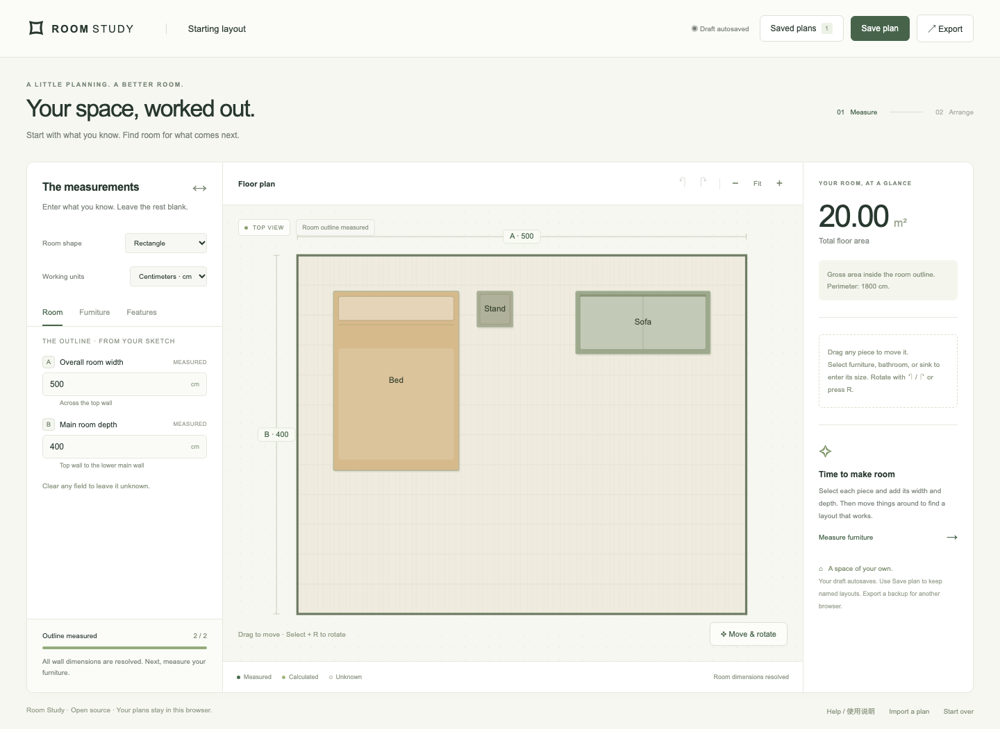

# Room Study · 房间布局

[English](README.en.md) · [在线使用](https://freyayerf.github.io/room-study/) · [下载离线版](https://github.com/freyayerf/room-study/releases/latest)

在浏览器中填写房间尺寸、绘制二维平面图、精确摆放家具，并保存不同布局方案。无需注册；图纸数据保存在自己的浏览器里。MIT 开源，允许任何人使用、修改和分发。



## 使用

- **在线使用**：打开上方在线地址。
- **离线使用**：在 Releases 下载 `room-study-v1.0.0.html`，双击即可；也可以下载 ZIP，解压后打开 `index.html`，同时获得完整说明和示例。
- **开发运行**：安装 Node.js 22 或更新的 LTS 版本，克隆后执行：

```sh
git clone git@github.com:freyayerf/room-study.git
cd room-study
npm ci
npm run dev
```

打开终端显示的本地地址（默认 `http://127.0.0.1:4173`）。不需要后端、数据库、API key 或全局 npm 包。普通使用者不需要 Node.js。

## 主要功能

- 三种可测量房型：矩形、L 形、凹位与入口组合房型；旧版本方案可直接导入。
- 厘米、米、英尺/英寸切换，内部尺寸统一使用厘米，切换单位不改变原始数值。
- 标明实测、推算、未知尺寸；约束可确定时自动推算，输入冲突时提示。
- 家具拖动、精确宽深及坐标输入、90° 旋转、锁定、撤销和重做。
- 可选浴室、水槽及左墙窗户设置；家具越界、相交提示。
- 本地草稿自动保存、命名方案、切换前自动保留修改副本。
- JSON 方案及方案库导入导出；SVG 完整平面图导出，不受当前缩放裁切。
- 响应式界面、键盘微调、内置中英文帮助；离线包不请求第三方字体或服务。

快捷键：`R` 顺时针旋转，`Shift+R` 逆时针旋转；方向键移动 1 cm，`Shift+方向键` 移动 10 cm；`Ctrl/Cmd+Z` 撤销，`Ctrl/Cmd+Shift+Z` 重做。先选择或聚焦家具。

## 精度和适用范围

输入数值是计算依据；未测量的房间或家具尺寸只按示意比例预览，界面以 `UNKNOWN`、`~` 或说明标识。面积由房型和已知尺寸计算，未知时不显示确定面积。显示保留两位小数，英尺以 0.1 英寸显示，内部值不因此舍入。碰撞检查容许 1 mm 以内的边界接触误差。

本版支持三种正交房型，不包含任意多边形绘制、多房间连接、斜墙、墙厚、门扇开启检查、3D 或施工规范校核。SVG 是矢量示意图，并非保证纸面 1:50 的施工图。家具位置随房间宽深按相对坐标存储；修改房间尺寸会移动家具相对于墙的绝对位置，家具的已测宽深保持不变。

## 保存和隐私

图纸与方案库保存在当前站点、浏览器和设备的 `localStorage`，不会上传到服务器。静态托管方仍会接收正常网页访问请求。离线文件不发起网络请求。公开仓库仅包含通用代码与合成示例，没有原始私人房间草图、截图或个人保存方案。

清除浏览数据、更换浏览器或从离线版切换到在线版时，不会自动同步。请先导出 JSON。浏览器禁用存储或空间不足时仍可编辑并导出，页面会提示无法自动保存。单个方案最多 100 件家具，方案库最多 1000 个条目，导入文件最大 25 MB。

## 开发与验证

```sh
npm run format        # 格式化
npm test              # 几何、单位、校验与存储测试
npm run build         # dist/index.html：独立离线 HTML
npx playwright install chromium firefox webkit
npm run test:e2e      # 桌面三种浏览器 + 手机视口
npm run release:check # 格式、测试、构建、浏览器测试、发布包与校验和
```

`npm ci` 使用锁文件；运行时没有第三方依赖。`npm run build` 的所有文件都在 `dist/`，可以直接部署到静态服务器，支持子路径。

## 仓库结构

```text
index.html                  页面结构
src/engine.js               约束求解、房型与几何碰撞
src/model.js                单位、默认状态、导入校验和旧版本兼容
src/layout-store.js         命名方案、备份、导入合并
src/app.js                  SVG 绘制、交互和浏览器存储
src/styles.css              响应式样式
scripts/                    本地服务、构建与跨平台 ZIP 打包
tests/                      单元和 Playwright 端到端测试
examples/                   合成示例，可通过 Import a plan 导入
docs/                       使用、维护、数据格式和发布说明
.github/workflows/          自动验证、Pages 部署、版本发布
```

## 发布流程

1. Pull Request 自动运行格式、单元、构建及浏览器测试。
2. 合入 `main` 后，通过相同验证，自动部署到 GitHub Pages。
3. 更新 `package.json`、锁文件和 `CHANGELOG.md`，提交后推送对应的 `vX.Y.Z` 标签。
4. Release 工作流再次验证版本和测试，生成 GitHub Release、离线 HTML、ZIP 和 SHA-256 校验和。

完整命令、首次启用 Pages 和回滚步骤见 [发布手册](docs/RELEASING.md)。下载校验见 [使用指南](docs/user-guide.html)。贡献前请阅读 [CONTRIBUTING.md](CONTRIBUTING.md)。

## 开源许可

[MIT](LICENSE)。项目从作者的个人房间布局工具整理为通用项目；旧数据的兼容逻辑保留在模型层，原始个人素材不随本仓库分发。
